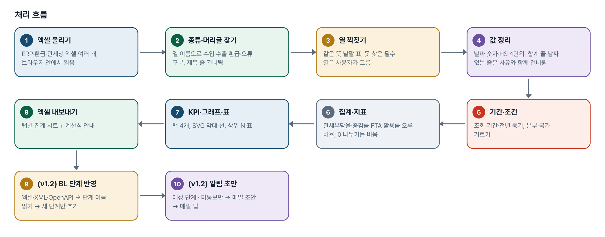
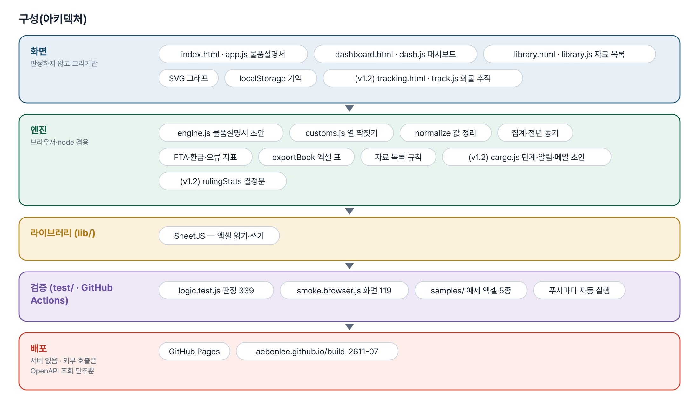
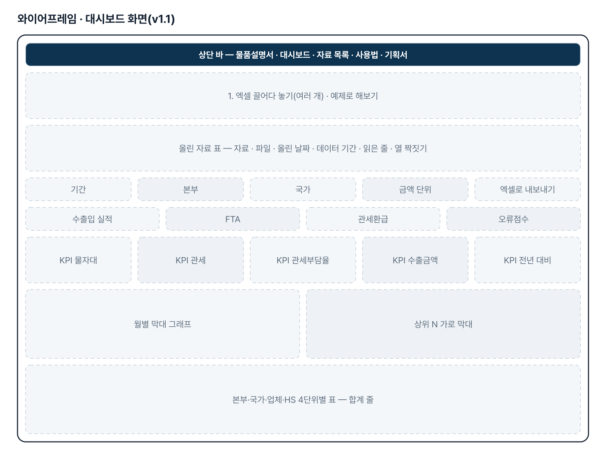
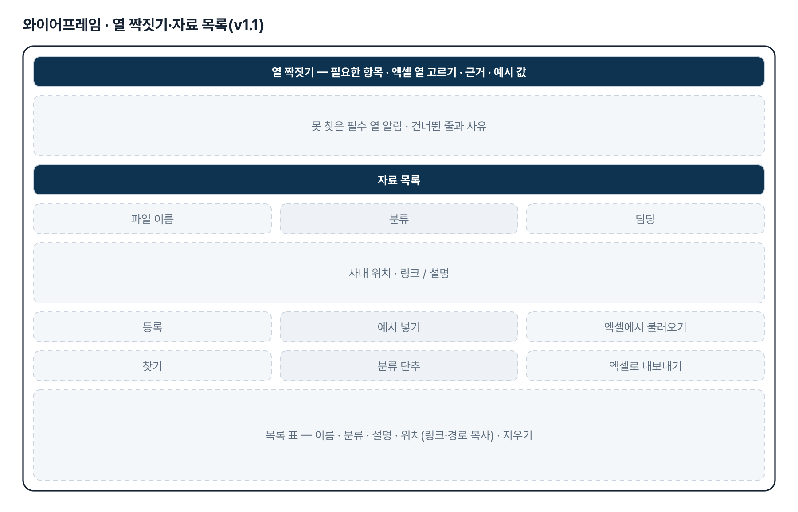
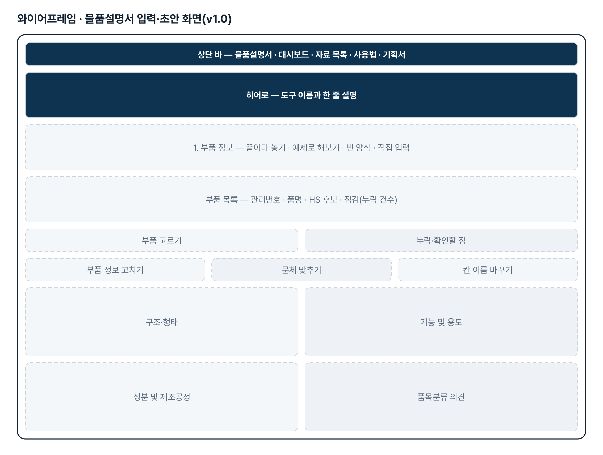
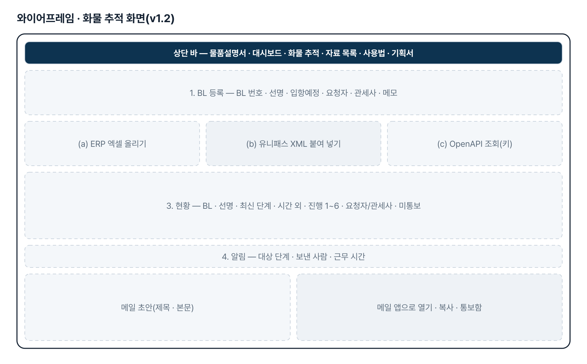
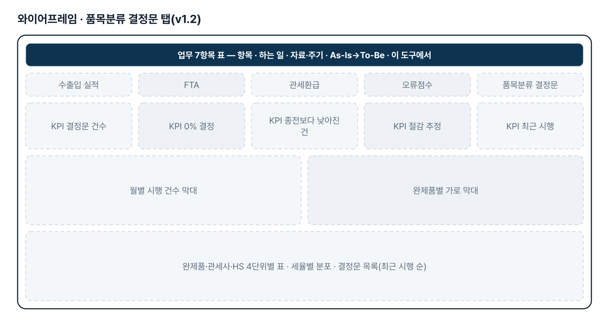
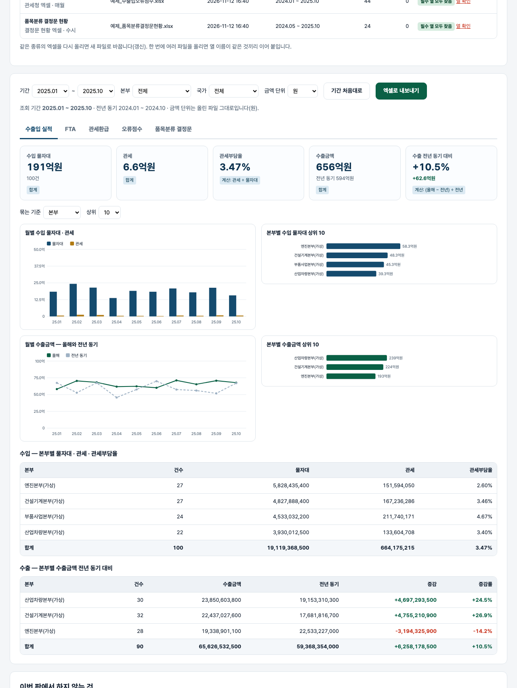

# 수출입통관 업무 대시보드 — 프로젝트 기획서 v1.4.2

- 기획: 최창섭 · 작성일 2026-11-12 · 생성형 AI 업무자동화 전문가과정 · 2차수 프로젝트 07
- 바로 쓰기: https://build-2611-07.jobability.co.kr/
- 워드 판: `docs/기획서/build-2611-07_최창섭_수출입통관업무대시보드_기획서_v1.4.2.docx`

## 개요

ERP·환급프로그램·관세청에서 내려받은 엑셀을 올리면 수출입 통관 실적(본부·국가·업체·HS 4단위), FTA 활용·절감액, 본부별 월별 관세환급, 수출입 오류점수, 품목분류 결정문 현황을 한 화면에서 집계하는 대시보드입니다. 열 이름이 달라도 같은 뜻 낱말로 찾고, 못 찾은 열은 사용자가 고릅니다. v1.2 는 기획자가 보낸 물품설명서 양식 6절에 맞춘 초안, 결정문 현황 모니터링, 수입보세화물 단계 알림(메일 초안)을 더했습니다. 통관 서식·매뉴얼 자료 목록이 함께 들어 있습니다.

### 배경 · 현재 업무
- 수입물품 품목분류 후 수입신고·FTA 신고·관세환급 업무를 합니다.
- 고관세 품목은 관세평가분류원에 품목분류를 질의하며, 이때 물품설명서를 냅니다.
- 종전에는 부품마다 AI 로 검색한 내용을 복사·붙여넣기로 양식에 옮겨 적었습니다.
- 빠진 항목이 있어도 작성 중에는 알아차리기 어렵고, 건마다 문체가 달라집니다.
- (v1.1) 통관 실적·FTA·환급·오류점수를 ERP·환급프로그램·관세청 엑셀에서 따로 정리해 보고합니다.
- (v1.1) 열 이름과 양식이 자료마다 달라 매번 손으로 집계표를 다시 만듭니다.
- (v1.2) 고세율 수입부품을 저세율로 품목분류 받으면 결정문이 오고, 그 실적을 따로 정리해 고정비 절감 효과를 모니터링합니다.
- (v1.2) 퇴근 후 들어오는 수입화물 통관 요청은 유니패스 화면에서 BL 진행 단계를 손으로 조회해 관세사·요청자에게 알렸습니다.

### 목표
- 부품 정보만 넣으면 물품설명서 네 칸 초안이 키 없이 만들어집니다.
- 필수 항목 누락과 HS 후보 표기 오류를 작성 단계에서 짚습니다.
- 여러 건을 엑셀로 한꺼번에 올리고 한꺼번에 내보냅니다.
- 과거 작성 사례의 문체를 따르고, 필요하면 AI 로 문장을 다듬습니다.
- (v1.1) 엑셀을 올리기만 하면 통관 실적·FTA·환급·오류점수 KPI 와 그래프가 나옵니다.
- (v1.1) 매일 다시 올려 갱신하고, 올린 날짜와 데이터 기간을 함께 보입니다.
- (v1.1) 통관 서식·업무 매뉴얼의 사내 위치를 목록으로 찾습니다.
- (v1.2) 물품설명서 초안을 기획자가 보낸 양식 6절(품명 / 구조 및 형태 / 기능 및 용도 / 성분(함량) 및 제조공정 / 제출서류 목록 / 품목분류 의견) 순서와 이름으로 만듭니다.
- (v1.2) 결정문 현황 엑셀을 올리면 결정 건수, 관세율 0% 결정 비율, 완제품·관세사별, 월별 시행 건수를 보고 절감 추정을 계산합니다.
- (v1.2) BL 을 등록하고 진행 단계를 넣으면 입항보고 제출·수입신고가 새로 생긴 건만 골라 메일 초안을 만듭니다. 메일은 사람이 보냅니다.

## 요구사항과 구현

| 기획서 요구 | 구현 |
|---|---|
| 물품설명서 양식 자동 작성 | 규칙 문장 틀로 네 칸 초안 — 키 없이 동작 |
| 작성 내용 4항목 | 구조·형태 / 기능 및 용도 / 성분 및 제조공정 / 품목분류 의견, 칸 이름은 설정에서 바꿈 |
| 고관세 품목 질의용 의견 | HS 후보 나열 · 다른 류 후보면 전용·범용 근거 요청 · 최종 판단은 담당자 문구 |
| 종전 복사·붙여넣기 작업 줄이기 | 엑셀 여러 건 일괄 → 목록·누락 점검 → 칸별 수정 → 일괄 내보내기 |
| 지정 양식에 자동 작성 | 인쇄용 표 양식(건마다 쪽 나눔) · 엑셀(물품설명서·입력·안내 시트) |
| 종전 작성 이력 활용 | 과거 작성 사례 붙여넣기 — 문장 끝맺음을 세어 문체만 따름 |
| AI 활용(선택) | OpenAI·Anthropic 중 선택, 보안 확인 후 전송, 결과는 「AI 초안 — 검토 필요」 |
| (v1.1) 수입현황: 물자대·관세·관세부담율, 본부·국가·업체·HS 4단위 | 관세부담율 = 관세 ÷ 물자대, 묶는 기준 4가지, 상위 N + 그 밖, 월별 막대 |
| (v1.1) 수출현황: 수출금액 전년대비 증감 | 전년 동기(같은 달 12개월 전) 대비 증감액·증감률, 전년에만 있던 묶음도 표시, 월별 올해·전년 선 |
| (v1.1) FTA 수출입 실적: 물자대/물자대_FTA/절감액 | 수입·수출 따로 FTA 활용률(물자대_FTA ÷ 물자대)·절감액, 본부·국가·업체별 |
| (v1.1) 본부별 매월 관세환급 실적 | 본부 × 월 표(행·열 합계), 월 평균, 최근 달 |
| (v1.1) 신고건수/오류건수/오류점수/비율 | 오류 비율 = 오류건수 ÷ 신고건수, 월별·구분(수입·수출)별 |
| (v1.1) ERP·관세청 엑셀, Real Time | 엑셀 여러 개 올리기 → 종류 알아보기 · 열 짝짓기(같은 뜻 낱말, 못 찾으면 사용자가 고름) · 다시 올리면 갱신 · 브라우저에 기억 |
| (v1.1) 통관서식/업무매뉴얼 공유 | 자료 목록 — 이름·분류·설명·사내 위치만 등록(파일은 저장하지 않음), 찾기·엑셀 내보내기/불러오기 |
| (v1.2) 물품설명서 양식 6절(메일 2026-11-04 09:40 첨부 양식) | 1절 품명은 머리글(품명·모델·상표·규격·적용 장비·HS 후보), 2~6절 다섯 칸을 초안으로. 5절 제출서류 목록은 입력한 붙임 자료와 해외 공급자 HS 를 나열 |
| (v1.2) 5-2 실적 모니터링 — 품목분류 결정문 접수 때 고정비 절감 실적 | 결정문 현황 엑셀(연번·완제품·품명·결정세번·결정문번호·시행일자·관세율·관세사) → 결정 건수 · 관세율 0% 건수와 비율 · 완제품/관세사/HS 4단위별 · 월별 · 세율별 분포 · 목록. 종전세율·연간 수입액 열이 있으면 절감 추정 |
| (v1.2) 6. 수입보세화물 Tracking — 입항보고제출·수입신고 때 관세사·요청자에게 전달 | tracking.html — BL 등록, ERP 엑셀/유니패스 XML/OpenAPI(키 있을 때) 로 단계 가져오기, 새로 생긴 대상 단계마다 메일 초안(mailto·복사), 통보 기록, 시간 외 표시 |
| (v1.2) 대시보드 7항목 구조(수출입통관업무Dashboard.xlsx 총괄 시트) | 대시보드 맨 위 「업무 7항목」 표 — 항목마다 자료·주기·As-Is→To-Be 와 이 도구의 위치 |
| (v1.3) 7. 4. 수출입통관 오류점수 분석 — 유니패스 귀책사유자별 오류현황·상세목록을 인천·울산으로 나눠 요약, 동일 신고번호 1건, 분기 300점 관리, AEO 관리대장·월별 공유 메일 | errors.html — 수입·수출 엑셀 → 부호별 인천/울산 → 월별 표·분기 경계·담당자 요약 표 대조·항목별 원인·관리대장 표·메일 초안·엑셀 |
| (v1.4) 내보내기에 워드 파일 추가 | 「워드(.docx)로 내보내기」 — 양식과 같은 짜임으로 부품마다 한 벌, 작성 안내 줄 선택 |

## 주요 기능

- **부품 정보 올리기** — 엑셀 한 장에 부품 한 줄. 열 이름이 조금 달라도 읽고, 모르는 열은 알립니다. 한 건 직접 입력도 됩니다.
- **누락 점검** — 필수 9칸과 HS 후보 자리수를 점검합니다. 목록에 누락 건수를 표시하고 초안에 「[확인 필요]」를 남깁니다.
- **규칙 초안** — 입력값을 문장 틀에 끼워 네 칸을 씁니다. 받침에 맞춰 조사를 고르고, 없는 값은 지어내지 않습니다.
- **문체 맞추기 · 칸 이름** — 과거 사례의 끝맺음(…입니다 / …이다 / …임·함)을 따릅니다. 양식 제목과 네 칸 이름을 바꿉니다.
- **AI 다듬기(선택)** — 보안 확인 후 전송합니다. 세율 수치는 지우고 단정 표현은 짚으며, 반영 단추를 눌러야 초안에 들어갑니다.
- **내보내기** — 엑셀(물품설명서·입력·안내)과 인쇄용 표 양식을 만듭니다. 작성 구분(규칙·직접 수정·AI)을 함께 남깁니다.
- **(v1.1) 엑셀 올리기·열 짝짓기** — 여러 파일을 한꺼번에 올리면 종류를 알아보고 머리글 줄을 찾습니다. 못 찾은 필수 열은 사용자가 고르고, 고른 짝은 기억합니다.
- **(v1.1) 수출입 실적·FTA** — KPI 카드(합계·계산 구분), 월별 그래프, 본부·국가·업체·HS 4단위 상위 표. 수출은 전년 동기 대비.
- **(v1.1) 관세환급·오류점수** — 본부 × 월 환급 표, 오류 비율 월별 선, 구분별 표. 0 으로 나누면 「—」.
- **(v1.1) 거르기·엑셀** — 기간·본부·국가 조건, 금액 단위 표기. 탭별 집계 시트와 계산식 안내를 엑셀로 내보냅니다.
- **(v1.1) 자료 목록** — 통관 서식·매뉴얼의 이름·분류·사내 위치를 등록하고 찾습니다. 경로 복사, 엑셀로 옮기기.
- **(v1.2) 양식 6절 초안** — 1절 품명 머리글, 2~6절 다섯 칸. 제출서류 목록 칸은 붙임 자료와 공급자 HS 를 나열하고 없으면 안내만 남깁니다.
- **(v1.2) 품목분류 결정문 탭** — 결정 건수·0% 결정 비율·절감 추정 카드, 월별 시행 건수 그래프, 완제품·관세사·HS 4단위별 표, 세율별 분포, 결정문 목록. 관세율 「FCN0」 같은 협정 부호도 읽습니다.
- **(v1.2) 화물 추적 — 단계 가져오기** — ERP 진행현황 엑셀(열 짝짓기), 유니패스 XML 붙여 넣기, OpenAPI 조회(인증키를 넣고 눌렀을 때만). 같은 BL·단계·처리일시는 두 번 넣지 않습니다.
- **(v1.2) 화물 추적 — 알림 초안** — 입항보고 제출·수입신고(바꿀 수 있음)가 새로 생긴 건마다 관세사·요청자 앞 메일 초안. 메일 앱으로 열기·복사·카톡용 한 줄, 통보함 표시, 메일 틀 편집, 시간 외 표시.
- **(v1.3) 오류점수 분석** — 신고번호 앞 5자리로 인천·울산을 나누고, 월별 건수·점수·비율, 분기 경계, 담당자 표 대조, 항목별 원인, 관리대장, 공유 메일 초안.

## 처리 흐름(파이프라인)

1. **엑셀 올리기** — ERP·환급·관세청 엑셀 여러 개, 브라우저 안에서 읽음
2. **종류·머리글 찾기** — 열 이름으로 수입·수출·환급·오류 구분, 제목 줄 건너뜀
3. **열 짝짓기** — 같은 뜻 낱말 표, 못 찾은 필수 열은 사용자가 고름
4. **값 정리** — 날짜·숫자·HS 4단위, 합계 줄·날짜 없는 줄은 사유와 함께 건너뜀
5. **기간·조건** — 조회 기간·전년 동기, 본부·국가 거르기
6. **집계·지표** — 관세부담율·증감률·FTA 활용률·오류 비율, 0 나누기는 비움
7. **KPI·그래프·표** — 탭 4개, SVG 막대·선, 상위 N 표
8. **엑셀 내보내기** — 탭별 집계 시트 + 계산식 안내
9. **(v1.2) BL 단계 반영** — 엑셀·XML·OpenAPI → 단계 이름 읽기 → 새 단계만 추가
10. **(v1.2) 알림 초안** — 대상 단계 · 미통보만 → 메일 초안 → 메일 앱

## 구성(아키텍처)

- **화면** — index.html · app.js 물품설명서 · dashboard.html · dash.js 대시보드 · library.html · library.js 자료 목록 · SVG 그래프 · localStorage 기억 · (v1.2) tracking.html · track.js 화물 추적
- **엔진** — engine.js 물품설명서 초안 · customs.js 열 짝짓기 · normalize 값 정리 · 집계·전년 동기 · FTA·환급·오류 지표 · exportBook 엑셀 표 · 자료 목록 규칙 · (v1.2) cargo.js 단계·알림·메일 초안 · (v1.2) rulingStats 결정문
- **라이브러리 (lib/)** — SheetJS — 엑셀 읽기·쓰기
- **검증 (test/ · GitHub Actions)** — logic.test.js 판정 339 · smoke.browser.js 화면 119 · samples/ 예제 엑셀 5종 · 푸시마다 자동 실행
- **배포** — GitHub Pages · aebonlee.github.io/build-2611-07

## 화면 구성(와이어프레임)

## 규칙 · 판정 기준

- 필수 9칸이 빠지면 초안에 「[확인 필요: 칸 이름]」을 남깁니다. 없는 값을 지어내지 않습니다.
- HS 후보는 4(호)·6(소호)·10(HSK)자리만 받습니다. 류 01~97 이 아니거나 77 이면 거릅니다.
- 품목분류 의견은 후보와 검토 사항만 적고, 끝에 「최종 품목분류는 담당자 검토」를 붙입니다.
- 관세율 수치는 싣지 않습니다. 세율·관세율·과세가 든 문장의 % 만 지우고 성분 % 는 남깁니다.
- 문체 3종(…입니다 / …이다 / …임·함)은 사례의 끝맺음 수로 고르고, 변환 뒤 「니다」가 남지 않아야 합니다.
- (v1.1) 열 짝: 이름 같음 1 · 같은 뜻 낱말 0.95 · 낱말 포함 0.6+0.3×(낱말/열 이름 길이), 0.6 이상 높은 짝부터 한 열 한 번. 사용자가 고른 짝이 앞섭니다.
- (v1.1) 관세부담율 = 관세 ÷ 물자대 · FTA 활용률 = 물자대_FTA ÷ 물자대 · 오류 비율 = 오류건수 ÷ 신고건수 · 증감률 = (올해 − 전년 동기) ÷ 전년 동기. 나누는 값이 0 이거나 비면 비웁니다.
- (v1.1) 전년 동기 = 같은 달들의 12개월 전. 기본 기간은 마지막 달이 든 해의 1월~마지막 달.
- (v1.1) 빈 금액은 0 으로 채우지 않습니다. 물자대_FTA 열의 빈칸은 FTA 미적용(0)으로 봅니다. 합계·소계 줄과 날짜 없는 줄은 사유와 함께 건너뜁니다.
- (v1.1) HS 4단위: 점 앞 3자리·홀수 자리는 앞의 0 을 되살리고, 류 01~97(77 제외)만 받습니다.
- (v1.2) 물품설명서 칸은 양식 6절의 2~6절이고 1절 품명은 머리글입니다. 제출서류 목록은 필수 칸이 아니며 없으면 안내 문장만 남깁니다.
- (v1.2) 관세율 「FCN0」은 협정 부호 FCN 과 세율 0 으로 읽습니다. 읽지 못한 값은 집계에서 뺍니다. 절감 추정 = 연간 수입액 × (종전세율 − 결정세율) ÷ 100 이며 세 값이 다 있는 건만 더합니다.
- (v1.2) 결정문 탭의 관세율은 올린 파일 값을 그대로 보입니다. 물품설명서 초안에 세율을 싣지 않는 규칙은 그대로입니다.
- (v1.2) 처리단계 이름은 긴 별칭부터 맞춥니다(「수입신고 수리」는 수리, 「수입신고」는 신고). 모르는 이름은 「그 밖」으로 남기고 버리지 않습니다.
- (v1.2) 같은 BL · 같은 단계 · 같은 처리일시는 한 번만 넣습니다. 통보한 단계는 BL·단계·처리일시로 기억해 다시 알리지 않습니다.
- (v1.2) 시간 외 = 근무 시간(기본 09:00~18:00) 밖 또는 토·일. 공휴일은 모릅니다.
- (v1.2) 메일은 보내지 않습니다. 초안을 만들고 mailto 로 메일 앱에 넘깁니다. 인증키는 화면·엑셀에 가려서만 보입니다.
- (v1.3) 신고번호 = 관세사부호 5자리 + 신고년도 2자리 + 고유번호, 끝 글자 M 수입 · X 수출. 앞 5자리가 울산 부호(기본 43908, 메일 규칙)면 울산, 아니면 인천. 부호 목록은 화면에서 고른다.
- (v1.3) 오류건수 = 신고번호 수(동일 신고번호 1건, 0점 포함). 오류점수 = 줄 점수 합. 비율 = 오류점수 ÷ 신고건수.
- (v1.3) 신고건수: 종합은 현황목록의 총신고건, 인천은 요약 시트 또는 사람이 입력, 울산 = 총신고건 − 인천. 인천 건수를 모르면 비워 둔다.
- (v1.3) 분기 경계 기본 300(같으면 이상), 80% 이상은 주의. 적용 범위가 확정 전이라 수출입·수입·수출 × 종합·인천·울산을 모두 보인다.
- (v1.3) 메일을 보내지 않는다. 초안의 1) 줄은 기획자 메일 형식대로 인천 기준이다.

## 검증

- 계산 규칙 테스트 425개 · 화면 연기 테스트 147개 통과
- v1.0 판정 91·v1.1 132 는 그대로 두고 v1.2 판정 116·화면 42 를 더했습니다(v1.0 의 칸 번호·이름 검사 11개는 양식 6절에 맞춰 고쳤습니다).
- 되돌려 확인했습니다 — 긴 별칭 우선을 끄면 「수입신고 수리」가 수입신고로 읽혀 2개, 같은 단계 중복 막기를 끄면 4개, 통보 기록을 끄면 3개, 시간 외 주말 판정을 끄면 1개, 협정 부호(FCN0) 읽기를 끄면 7개, 절감 추정 조건(세 값이 다 있을 때만)을 풀면 1개가 실패하고, 제출서류 칸을 빼면 테스트가 멈춥니다. 모두 원복 후 339 통과.
- 화면 테스트: 다섯 칸 초안·인쇄 1~6절 → 7항목 표 → 결정문 탭 카드 = 엔진 계산 → 엑셀 시트 → 화물 추적(등록 → XML → 엑셀 → 알림 3건 → 통보 → 대상 바꾸기 → 열 고르기 → 가짜 OpenAPI 응답 → 키 가림 → 엑셀 → 360px).
- (v1.3) 판정 65 · 화면 18 추가. 되돌려 확인: 동일 신고번호 1건 끄기(줄 수로 세기) 2개 · 인천·울산 뒤집기 16개 · 경계 같음 포함 끄기 1개 · 빈 시트 처리 끄기 1개 · 메일 1) 줄을 종합으로 1개 · 0점 신고도 대장에 1개 · 인천 건수 모르면 짐작 1개 실패 → 원복 404.
- (v1.3) 화면 테스트는 VM 부하(load 100~300)로 전체 한 번에 끝나지 않아, v1.0~1.2 119개(기능 코드 변경 전 판 + 메뉴 추가)와 v1.3 18개를 나눠 통과시켰다.
- (v1.3) 실제 파일 대조(메일 탭 안에서, 값은 저장소에 없음): 울산 부호를 메일의 한 개로 두면 앞쪽 달 점수가 담당자 표와 다르고, 자료에 나온 부호 두 개를 더 고르면 월별 수입·수출 18개 중 17개가 맞는다. 나머지 1개는 수출 5월 신고번호 2건의 캠퍼스 구분 차이로 기획자 확인 대기.
- (v1.4) 판정 21 추가(워드 XML 짜임 · 양식 글자 크기 · 특수문자 · 줄바꿈 · 작성 안내 켬/끔 · 누락 표시). 워드 화면 테스트는 따로 둠(test/smoke.docx.browser.js 10개) — 내려받은 docx 를 풀어 내용 확인. 기존 전체 화면 테스트 135개도 통과(화물 추적 360px 넘침을 고친 뒤).

## 이번 판에서 하지 않는 것

- HS 코드를 확정하지 않습니다 — 「후보 · 검토 필요」로만 적고 최종 판단은 담당자가 합니다.
- 관세율 수치는 싣지 않습니다.
- 관세청 공식 서식을 재현하지 않습니다 — 첨부 양식에 맞춰 칸 이름을 바꾸는 방식입니다.
- 실제 AI 호출은 아직 확인하지 않았습니다(요청 모양만 테스트로 고정).
- (v1.1) 「실시간」은 매일 엑셀을 다시 올리는 방식입니다. ERP·관세청과 자동으로 잇지 않습니다.
- (v1.1) 예제 열 이름은 지어낸 것입니다. 실제 ERP 엑셀의 열 이름을 받아 같은 뜻 낱말 표를 늘려야 합니다.
- (v1.1) 금액 단위·통화를 바꾸지 않습니다. 파일마다 단위가 다르면 합계가 섞입니다.
- (v1.2) 메일을 자동으로 보내지 않고 유니패스를 자동 감시하지 않습니다. 사람이 엑셀을 올리거나 「조회」를 누를 때 읽습니다. 정해진 시각마다 조회하는 일은 사내 서버(배치) 몫입니다.
- (v1.2) OpenAPI 직접 조회는 브라우저가 막을 수 있습니다(CORS). 막히면 조회 주소를 새 탭에 열어 XML 을 붙여 넣는 방식입니다. 실제 관세청 응답 태그 이름은 연계가이드로 대조하지 못했습니다 — 태그 표(TAGS)를 늘리면 됩니다.
- (v1.2) 공휴일은 「시간 외」로 판정하지 않습니다.
- (v1.2) 「02_AI 물품설명서 프롬프트 검토 양식」 엑셀은 DRM 으로 열리지 않아 반영하지 못했습니다(해제본 요청).
- (v1.3) 유니패스에 접속하지 않는다(받은 엑셀을 올린다). 대시보드 「오류점수」 탭의 비율은 v1.1 정의(오류건수 ÷ 신고건수) 그대로이고, 오류점수 화면의 비율은 기획자 실제 표 정의(오류점수 ÷ 신고건수)다. 첨부 「인천_울산캠퍼스구분자」 파일은 시트가 비어 있어 읽을 내용이 없었다.

## 다음 단계

- 기획자가 공유할 관세청 양식에 맞춘 칸 이름 기본값, 필요하면 Word 내보내기
- 과거 작성 사례 모음과 비슷한 품명 사례 찾기
- 결정문의 근거 문장 틀을 표로 받아 의견 문장 틀 늘리기
- (v1.1 이후) 기획자 실제 엑셀 열 이름으로 같은 뜻 낱말 표 보강
- (v1.1 이후) 본부별 목표 대비 달성률, 월 마감 보고서 한 장(인쇄)
- (v1.2 이후) 프롬프트 검토 양식(DRM 해제본)을 받아 AI 다듬기 지시문과 검토 칸을 그 양식에 맞추기
- (v1.2 이후) 유니패스 연계가이드의 실제 응답 태그로 TAGS 표 보강, 사내 서버 배치(정해진 시각 조회 → 메일) 설계
- (v1.2 이후) 결정문 현황에 종전세율·연간 수입액 열을 붙여 절감 실적을 실제 값으로
- (v1.3 이후) 기획자 확인: 울산 부호 목록 · 수출 5월 2건 · 0점 신고를 건수에 넣을지 · 300점 적용 범위 · 구분자 파일 재전송

## 버전 이력

- **v1.4.2** (2026-11-13) — 대시보드 — 예제 엑셀 5종을 모두 받을 수 있게 함(기획자 요청): 「5종 한꺼번에 받기(ZIP)」 단추와 종류별 내려받기 링크. 그전에는 수입 예제만 받을 수 있었음 / 첫 화면 사진 3장 · 문구(기획자 제공)
- **v1.4.1** (2026-11-12) — 상단 메뉴 순서 변경(기획자 요청) — 대시보드 · 화물 추적 · 오류점수 · 물품설명서 · 자료 목록 · 사용법 · 기획서. 첫 화면 주소와 기능은 그대로
- **v1.4** (2026-11-12) — 물품설명서 「4. 내보내기」에 워드(.docx) 내보내기 추가 — 보내 주신 물품설명서 양식과 같은 짜임(제목 · 1~6절 · 작성 안내 ☞ · A4 여백), 부품마다 새 쪽 / 작성 안내 줄을 넣거나 빼는 선택, 화면에서 고친 문장 · AI 반영 표시 · 누락 표시가 워드에도 그대로 / 화물 추적 화면의 BL 선택 상자가 360px 에서 화면 밖으로 나가던 것 고침 / 판정 425(v1.4 21) · 워드 화면 10
- **v1.3** (2026-11-04) — 기획자 메일(2026-11-04 오후, 「7.수출입통관Dashboard_4.수출입통관오류점수분석」, 엑셀 4개) 대응 / 오류점수 분석 화면 errors.html · js/errors.js · js/errscore.js / 판정 339→404 · 화면 119→137
- **v1.2** (2026-11-04) — 메일 2통(2026-11-04 07:45 「6. 수입보세화물Tracking 구축」 · 09:40 「5. 물품설명서 작성 자동화」)의 자료 반영 / 물품설명서 초안을 양식 6절(품명 머리글 + 2~6절 다섯 칸)로 — 제출서류 목록·공급자 HS·상표 칸 추가, 인쇄 양식 절 번호 / 대시보드 「품목분류 결정문」 탭(결정 건수·0% 결정 비율·절감 추정·완제품/관세사/HS 4단위·월별·목록) · 맨 위 「업무 7항목」 표 · 예제 엑셀 5종 / 화물 추적(tracking.html · js/cargo.js · js/track.js): BL 등록, ERP 엑셀/유니패스 XML/OpenAPI 로 단계 가져오기, 새 단계 알림 메일 초안, 통보 기록, 시간 외, 엑셀 / 테스트 판정 222→339 · 화면 77→119
- **v1.1** (2026-11-03) — 추가 요청(게시물 4128396865 「(기획v1.0)수출입통관업무Dashbord」) — 수출입통관 업무 대시보드 / 대시보드(dashboard.html): 엑셀 여러 개 올리기·종류 알아보기·열 짝짓기, 수출입 실적·FTA·관세환급·오류점수 탭, 기간·본부·국가 거르기, 탭별 집계 엑셀 / 엔진 js/customs.js · 예제 엑셀 4종 samples/ · 통관 서식·매뉴얼 자료 목록(library.html) / 테스트 판정 91→222 · 화면 23→77
- **v1.0** (2026-11-02) — 첫 판 — 부품 정보 일괄 입력·누락 점검·네 칸 규칙 초안·문체 맞추기·칸 이름 설정·AI 다듬기(선택)·엑셀·인쇄 양식 / 기획서 워드 판·파이프라인·아키텍처·와이어프레임 추가
